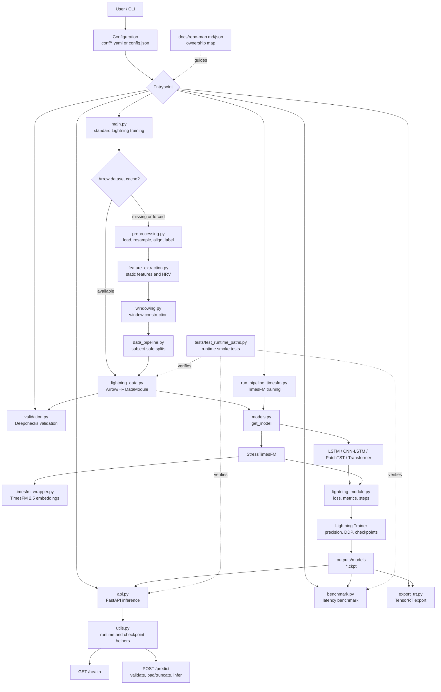

# StressProject

<p align="center">
  
</p>

StressProject is a physiological time-series machine learning project for
stress detection. It supports end-to-end preprocessing, subject-safe dataset
splitting, PyTorch Lightning training, TimesFM 2.5 foundation-model experiments,
FastAPI inference, benchmarking, TensorRT export, validation, and repository
governance tooling.

The root repository owns the stress-prediction pipeline. The `timesfm/`
directory is a packaged TimesFM workspace with its own guidance and should be
treated as a separate subproject when making changes under that tree.

## Capabilities

- **Signal processing pipeline**: load physiological signals, resample and align
  channels, extract static features, build time-series windows, and generate
  train/validation/test splits without subject leakage.
- **Dataset conversion**: convert processed arrays into Arrow/Hugging Face
  datasets for repeatable training and faster reloads.
- **Model training**: train LSTM, CNN-LSTM, PatchTST-style Transformer,
  Transformer, and TimesFM-backed
  stress classifiers with PyTorch Lightning.
- **Experiment tuning**: run tuning helpers for model and training-parameter
  sweeps while keeping the canonical Hydra and JSON configs as the source of
  runtime defaults.
- **Runtime optimization**: detect CUDA, Apple MPS, MLX installation,
  precision, TF32, TensorRT, and Torch-TensorRT availability through shared
  runtime utilities.
- **Inference service**: serve trained checkpoints through a FastAPI API with
  health reporting, input validation, checkpoint loading, sequence
  pad/truncate handling, and preallocated inference buffers.
- **Interactive analysis utilities**: use the dashboard, visualization, and
  notebook surfaces for inspection, calibration, and result exploration.
- **Foundation-model path**: run dedicated TimesFM 2.5 training through
  `run_pipeline_timesfm.py` and `timesfm_wrapper.py`.
- **Validation and benchmarking**: run Deepchecks integrity checks, latency
  benchmarks, TensorRT export, and runtime smoke tests.
- **Model evaluation**: compute classification metrics, compare experiment
  outputs, and keep diagnostics separate from training entrypoints.
- **Repository intelligence**: use `docs/repo-map.md`, `docs/repo-map.json`,
  AGENTS guidance, and GitNexus to navigate ownership and impact safely.

## Application Features

StressProject is organized as a research-to-runtime application rather than a
single training script. The core app features are:

- **End-to-end stress prediction workflow**: raw physiological signals flow
  through preprocessing, feature extraction, windowing, subject-safe splitting,
  model training, checkpoint selection, inference, and diagnostics.
- **Physiological signal support**: pipeline modules are structured around
  wearable-style time-series inputs such as EDA, BVP, ACC, TEMP, respiration,
  labels, and derived static or HRV-style features.
- **Subject-safe evaluation**: split utilities keep subject boundaries intact
  so validation and test metrics are not inflated by subject leakage.
- **Multiple model families**: the training stack supports recurrent,
  convolutional-recurrent, PatchTST-style, Transformer, and TimesFM-backed
  classifiers through the shared model factory.
- **Foundation-model experimentation**: TimesFM 2.5 integration is isolated
  behind `timesfm_wrapper.py`, with the packaged `timesfm/` project treated as
  its own subproject.
- **FastAPI runtime**: the API exposes health and prediction endpoints, loads
  the best available checkpoint, validates request shape, normalizes sequence
  length, and returns probability, class label, and confidence.
- **Hardware-aware execution**: shared utilities detect CUDA, Apple MPS, MLX
  installation, and precision capabilities, allow TF32 where available, and
  keep CPU fallback viable for smoke tests and local debugging.
- **Production-oriented export path**: TensorRT export and latency benchmarks
  provide a path from research checkpoints to optimized inference artifacts.
- **Validation and observability surfaces**: Deepchecks validation, evaluation
  helpers, visualization utilities, calibration notebooks, logs, and benchmark
  outputs support model-quality review.
- **Governed repository navigation**: the repo map and GitNexus index define
  ownership, dependencies, execution flows, and change-impact expectations.

## Architecture



## Project Structure

```text
.
|-- conf/                       # Hydra configuration groups
|   |-- config.yaml             # Main config composition
|   |-- dataset/wesad.yaml      # Dataset metadata and sampling rates
|   |-- model/*.yaml            # Model-specific settings
|   |-- processing/default.yaml # Preprocessing/windowing settings
|   `-- training/standard.yaml  # Training settings
|-- docs/
|   |-- repo-map.md             # Canonical repo ownership and dependency map
|   |-- repo-map.json           # Machine-readable repo map
|   `-- repo-map-refresh.ps1    # Map refresh helper
|-- tests/
|   |-- test_runtime_paths.py   # DataModule/API/benchmark smoke tests
|   |-- test_mlx_models.py      # MLX model inference tests
|   |-- test_mlx_convert.py     # Checkpoint conversion tests
|   |-- test_mlx_timesfm_training.py # TimesFM MLX head training tests
|   `-- test_timesfm_lora_inference.py # TimesFM LoRA inference tests
|-- timesfm/                    # Packaged TimesFM project and local source
|-- main.py                     # Primary Lightning training entrypoint
|-- run_pipeline.py             # Legacy/alternate training pipeline
|-- run_pipeline_timesfm.py     # TimesFM 2.5 training pipeline
|-- run_lightning.py            # Lightning run helper
|-- api.py                      # FastAPI inference server
|-- evaluate_checkpoint.py      # Held-out checkpoint evaluation and threshold artifact writer
|-- benchmark.py                # Runtime latency benchmark
|-- export_trt.py               # TensorRT export helper
|-- validation.py               # Deepchecks integrity validation
|-- data_loader.py              # Raw data loading
|-- preprocessing.py            # Preprocessing orchestration
|-- signal_processing.py        # Resampling and alignment
|-- feature_extraction.py       # Static feature and HRV extraction
|-- windowing.py                # Time-series window construction
|-- data_pipeline.py            # Splits, sampling, DataLoader construction
|-- lightning_data.py           # LightningDataModule
|-- lightning_module.py         # LightningModule wrapper
|-- models.py                   # Model architectures and factory
|-- timesfm_wrapper.py          # TimesFM backbone loader and extractor
|-- utils.py                    # Config, runtime, checkpoint utilities
|-- config.json                 # Legacy/runtime JSON config
|-- callbacks.py                # Telemetry & diagnostic callbacks for Lightning
|-- convert_checkpoint_to_mlx.py # PyTorch to MLX checkpoint converter
|-- convert_all_checkpoints_to_mlx.py # Batch converter for MLX checkpoints
|-- timesfm_lora.py             # TimesFM LoRA fine-tuning implementation
|-- mlx_backend.py              # Apple MLX runtime detection and configuration
|-- mlx_benchmark.py            # Benchmark utility for MLX model execution
|-- mlx_convert.py              # MLX checkpoint converter helpers
|-- mlx_hybrid.py               # Hybrid MLX/PyTorch execution for TimesFM
|-- mlx_models.py               # MLX-native implementations of core models
|-- mlx_timesfm_training.py     # MLX-native TimesFM classification head training
|-- mlx_training.py             # Training loop, optimizer, and data utils for MLX
|-- performance_guard.py        # Latency SLA enforcement checks
|-- quantize_cpu.py             # Post-training static CPU quantization utility
|-- requirements.txt            # Python dependencies (common)
|-- requirements-apple.txt      # Apple Silicon dependencies (MLX, etc.)
|-- requirements-cuda.txt       # CUDA-specific dependencies
|-- verify_cuda_python.py       # Checks cuda-python package driver and runtime API compatibility
|-- verify_cuda_python_ipc.py   # Checks CUDA IPC compatibility for multi-process communication
`-- verify_deployment.ps1       # Pre-deployment validation script (tests, SLAs, benchmarks)
```

Runtime and experiment artifacts are not source-of-truth by default:
`outputs/`, `scratch/`, `.venv/`, and `__pycache__/`.

## Installation

```powershell
python -m venv .venv
.\.venv\Scripts\Activate.ps1
pip install -r requirements.txt
```

For CUDA acceleration, install the PyTorch build that matches the local CUDA
runtime before installing project dependencies.

On Apple silicon, use the standard PyTorch macOS build and install MLX for
native GPU training and inference:

```bash
pip install -r requirements-apple.txt
```

The stack auto-selects MLX on Apple Silicon for **LSTM**, **CNN-LSTM**, **Transformer**,
and **PatchTST** when `STRESS_BACKEND=auto` (default). TimesFM remains PyTorch-only.
Use `STRESS_TORCH_DEVICE=mps` to force the PyTorch MPS path instead.

```bash
# Auto MLX on Apple Silicon
python main.py model=patchtst

# Force MLX
STRESS_BACKEND=mlx python main.py model=cnn_lstm

# Force PyTorch MPS
STRESS_BACKEND=mps python main.py model=cnn_lstm

# MLX inference benchmark
python mlx_benchmark.py --config config.json --checkpoint outputs/models/best_patchtst_mlx.npz
```

MLX checkpoints are saved as `outputs/models/best_<model>_mlx.npz` and are used
automatically by the API when MLX is enabled. Convert existing PyTorch checkpoints:

```bash
python convert_checkpoint_to_mlx.py --checkpoint outputs/models/best_model.ckpt
```

Set `STRESS_MLX_AUTO_CONVERT=0` to disable on-the-fly conversion in the API.
TimesFM uses a hybrid path: PyTorch backbone embeddings + MLX classification head.

TimesFM Phase 1 (frozen backbone, MLX head training) is enabled by default on
Apple Silicon. Phase 2 backbone fine-tuning still runs in PyTorch/Lightning.

```bash
# Disable MLX Phase 1 for TimesFM (use full PyTorch head training)
TIMESFM_MLX_PHASE1=0 python main.py model=timesfm

# Batch-convert all checkpoints under outputs/models/
python convert_all_checkpoints_to_mlx.py --input-dir outputs/models --recursive
```

TimesFM MLX head checkpoints are saved as `outputs/models/best_timesfm_head_mlx.npz`.

Phase 2 on Apple Silicon defaults to **LoRA fine-tuning** on the last TimesFM blocks
(`TIMESFM_LORA_PHASE2=auto`) instead of full backbone unfreeze. After Phase 2,
`STRESS_MLX_EXPORT_HEAD=1` (default) refreshes the MLX head for hybrid inference.

| Variable | Default | Purpose |
|----------|---------|---------|
| `STRESS_BACKEND` | `auto` | `mlx`, `mps`, `cuda`, `cpu` |
| `STRESS_MLX_COMPILE` | `1` | `mx.compile` training steps |
| `STRESS_MLX_DEVICE` | `gpu` | MLX device (`gpu` / `cpu`) |
| `STRESS_MLX_PRELOAD_MAX_GB` | `4` | HF split preload cap for MLX training |
| `STRESS_MLX_DTYPE` | `float32` | MLX compute dtype (`bfloat16`/`float16` opt-in; loss stays float32) |
| `STRESS_MLX_AUTO_CONVERT` | `1` | API on-the-fly ckpt→MLX |
| `STRESS_MLX_EXPORT_HEAD` | `1` | Export TimesFM MLX head after Phase 2 |
| `TIMESFM_MLX_PHASE1` | `1` | MLX head training in Phase 1 |
| `TIMESFM_LORA_PHASE2` | `auto` | LoRA vs full unfreeze in Phase 2 |
| `TIMESFM_LORA_RANK` | `8` | LoRA rank |
| `TIMESFM_LORA_ALPHA` | `16` | LoRA scaling |

`quantize_cpu.py` supports PyTorch checkpoints only (`--backend torch` to force). MLX models use `mlx_benchmark.py`.

`run_pipeline.py` (legacy PyTorch DataLoader path) also auto-selects MLX training on
Apple Silicon for supported models via `run_mlx_training_loaders`.

On this Windows workstation, use the repo CUDA launcher as the default Python
entrypoint for training and diagnostics:

```powershell
.\cuda_python.ps1 -c "import torch; print(torch.cuda.is_available(), torch.cuda.get_device_name(0))"
```

`cuda_python.ps1` defaults to `C:\conda-data\envs\cuda_torch_env\python.exe`,
sets `STRESS_TORCH_DEVICE=cuda` when the variable is unset, and adds the repo
root to `PYTHONPATH`. Override the interpreter with `STRESS_CUDA_PYTHON` if the
CUDA conda env moves.

## Configuration

The project has two configuration surfaces:

- `conf/config.yaml` composes the main Hydra configuration for dataset,
  processing, model, and training settings.
- `config.json` keeps legacy and runtime defaults used by the API and utility
  scripts.

Key settings to verify before a run:

- Dataset path, subject IDs, sampling rates, and channel names in
  `conf/dataset/wesad.yaml`.
- Window size, stride, resampling behavior, and preprocessing controls in
  `conf/processing/default.yaml`.
- Model type and architecture-specific hyperparameters in `conf/model/*.yaml`.
- Batch size, epochs, precision, accelerator settings, and checkpoint behavior
  in `conf/training/standard.yaml`.
- API/runtime checkpoint and context-length assumptions in `config.json`.

Hydra overrides can be passed on the command line. For example:

```powershell
.\cuda_python.ps1 main.py model=cnn_lstm training.epochs=20
.\cuda_python.ps1 main.py force_preprocess=True processing.windowing.window_size_sec=30
```

## Common Workflows

### Optimized Hardware Runs

The training stack selects CUDA first, then Apple MPS, then CPU. Use
`cuda_python.ps1` by default on this machine so the CUDA-enabled conda env is
used automatically. Override the selected backend only when needed:

```powershell
.\cuda_python.ps1 main.py
$env:STRESS_TORCH_DEVICE = "mps";  python main.py
$env:STRESS_TORCH_DEVICE = "cpu";  python main.py
```

CUDA runs use TF32 where available and Lightning mixed precision from runtime
capability detection. On Apple Silicon, MLX is preferred for LSTM, CNN-LSTM,
Transformer, and PatchTST when installed (`requirements-apple.txt`). MPS remains
the PyTorch/Lightning path and is required for TimesFM.

Use PatchTST for a modern patch-based Transformer baseline:

```powershell
.\cuda_python.ps1 main.py model=patchtst
```

CUDA graph compilation is available as an opt-in because Windows and compiler
setup can make `torch.compile` environment-sensitive:

```powershell
.\cuda_python.ps1 main.py training.torch_compile=true
```

DataLoader throughput is controlled in `conf/processing/default.yaml` and
`config.json` with `dataloader_num_workers`, `dataloader_prefetch_factor`,
`pin_memory`, and `persistent_workers`.

Long Windows runs disable Lightning's Rich progress bar by default to avoid
console rendering failures during W&B/redirected logging. Turn on a short native
profiler pass when investigating GPU kernels or loader stalls:

```powershell
$env:STRESS_PROFILE_TRAINING = "1"
$env:STRESS_PROFILER_DIR = "outputs/profiler_results"
.\cuda_python.ps1 main.py training.epochs=2
```

Classifier checkpoints are selected by validation-loss filename, preferring full
TimesFM phase-2 checkpoints when available. The API reuses a calibrated threshold
from `outputs/results/eval_pass*.json` when it can match one to the selected
checkpoint, falling back to the newest calibration artifact before using `0.5`.
After a training run, refresh that artifact with:

```powershell
.\cuda_python.ps1 evaluate_checkpoint.py
```

### Train the Standard Pipeline

```powershell
.\cuda_python.ps1 main.py
```

Regenerate the Arrow/Hugging Face dataset cache:

```powershell
.\cuda_python.ps1 main.py force_preprocess=True
```

### Train the TimesFM Pipeline

```powershell
.\cuda_python.ps1 run_pipeline_timesfm.py
```

### Start the Inference API

```powershell
.\cuda_python.ps1 api.py
```

Check service health:

```powershell
curl http://localhost:8000/health
```

Submit a prediction request:

```powershell
curl -X POST http://localhost:8000/predict `
  -H "Content-Type: application/json" `
  -d "{\"sequence\": [[0,0,0,0,0,0,0,0]]}"
```

The API loads the newest checkpoint from `outputs/models`, rebuilds the model
from configuration, validates the request, pads or truncates sequences to the
configured context length, and returns stress probability, label, and
confidence.

Primary API surface:

| Endpoint | Method | Purpose |
| --- | --- | --- |
| `/health` | `GET` | Reports API readiness and model/checkpoint health. |
| `/predict` | `POST` | Runs stress prediction for one physiological sequence. |

Prediction requests should provide a numeric two-dimensional `sequence` array:

```json
{
  "sequence": [
    [0.1, 0.2, 0.0, 0.5, 36.7, 0.3, 0.2, 0.1]
  ]
}
```

Prediction responses include the model probability, binary stress label, and
confidence score. Invalid shapes or non-numeric values should be rejected before
model execution.

### Benchmark, Validate, and Export

```powershell
.\cuda_python.ps1 benchmark.py
.\cuda_python.ps1 validation.py
.\cuda_python.ps1 export_trt.py --ckpt outputs/models/best_model.ckpt
```

## Performance & Diagnostics

StressProject includes an extensive telemetry suite for identifying hardware bottlenecks and optimizing production throughput:

### Training Telemetry
- **Bottleneck Analysis**: `BatchTimeLoggingCallback` calculates the exact ratio of Data Loading vs. GPU Compute. High "I/O Starvation" alerts will trigger if data loading exceeds 30% of step time.
- **Step Internals**: `StressLightningModule` logs per-step unpack, forward, loss, metric-update, logit, label, backward, pre-optimizer, optimizer-step, and optional CUDA-synchronized timing metrics.
- **Numerical Stability**: `NumericalStabilityCallback` monitors for NaNs/Infs in Loss, Gradients, and Weights in real-time, aborting training before resources are wasted.
- **Hardware Saturation**: Logs nanosecond-precision CUDA kernels, Peak VRAM usage, and GPU memory fragmentation levels per epoch.
- **Execution Tracing**: Supports `PyTorchProfiler` for generating Chrome Trace files (`.json`) compatible with `chrome://tracing` for kernel-level visualization.

### Inference & Deployment Benchmarking
- **High-Resolution Benchmarks**: `benchmark.py` provides percentile-based latency (P50, P90, P99) and VRAM footprint tracking.
- **Optimization Speedups**: Automatically compares Standard FP32 vs. AMP (FP16) vs. `torch.compile` vs. CUDAGraphs.
- **TensorRT Verification**: `export_trt.py` immediately benchmarks the generated engine against the raw PyTorch model to report the empirical speedup (e.g., "⚡ 4.25x speedup").

### Observability Dashboard
Run the Streamlit dashboard to visualize these metrics:
```powershell
streamlit run dashboard.py
```
Use the **"🏎️ Performance Diagnostics"** tab to view throughput trends, data loading overhead pies, and GPU memory health over the course of an experiment.
The dashboard also surfaces internal step timing so forward-pass, loss, metric-update, backward, and optimizer bottlenecks are visible from `metrics.csv`.

Additional app and experiment utilities:

```powershell
.\cuda_python.ps1 evaluation.py
.\cuda_python.ps1 visualization.py
.\cuda_python.ps1 tuning.py
.\cuda_python.ps1 dashboard.py
.\cuda_python.ps1 convert_to_hf.py
```

Use these only when their input artifacts exist. In particular, visualization,
dashboard, and evaluation paths usually expect completed training outputs,
processed datasets, or saved checkpoints.

### Run Tests

```powershell
.\cuda_python.ps1 -m pytest tests/test_runtime_paths.py
```

The runtime smoke tests cover Lightning batch handling, Arrow-backed
DataModule batches, API initialization and prediction on CPU, and benchmark
execution.

## Outputs and Artifacts

Generated artifacts are intentionally separated from source files:

| Path | Contents |
| --- | --- |
| `outputs/models/` | Lightning checkpoints and selected model artifacts. |
| `outputs/` | Training logs, metrics, benchmark results, and generated runtime outputs. |
| `scratch/` | Temporary experiments and disposable local work. |
| `.venv/` | Local Python environment. |
| `__pycache__/` | Python bytecode cache. |

Do not treat generated artifacts as source-of-truth unless a task explicitly
targets experiment outputs, model artifacts, or benchmark results.

## Development Notes

- Start broad investigations from `docs/repo-map.md`; it is the canonical
  ownership and dependency map.
- Keep root-level scripts focused on stress-prediction workflows. Changes under
  `timesfm/` follow `timesfm/AGENTS.md` and the packaged TimesFM project
  conventions.
- Run GitNexus impact analysis before editing functions, classes, or methods.
- Refresh the repo map after structural moves, new source files, or ownership
  changes.
- Prefer focused tests for the touched runtime path before broad experiment
  reruns.

## Useful Docs

| Document | Purpose |
| --- | --- |
| `docs/repo-map.md` | Canonical ownership matrix, source index, and dependency anchors. Start here before broad edits. |
| `docs/repo-map.json` | Machine-readable version of the repo map for automation and tooling. |
| `docs/repo-map-refresh.ps1` | Regenerates the markdown and JSON repo maps after structural file changes. |
| `AGENTS.md` | Top-level agent policy for navigation, ownership, GitNexus use, and repo-map upkeep. |
| `CLAUDE.md` | Parallel top-level assistant guidance for this repository. |
| `timesfm/AGENTS.md` | Additional guidance for the packaged TimesFM subproject. |
| `conf/config.yaml` | Main Hydra config composition. |
| `config.json` | Legacy/runtime JSON config used by API and utility paths. |
| `tests/test_runtime_paths.py` | Minimal runtime verification surface for the main Python paths. |

Refresh the repo map after structural moves or ownership changes:

```powershell
pwsh .\docs\repo-map-refresh.ps1 -RepoRoot (Get-Location).Path
```

GitNexus is configured for this repository. Use it to inspect unfamiliar
execution flows, run impact analysis before symbol edits, and detect affected
flows before committing.
